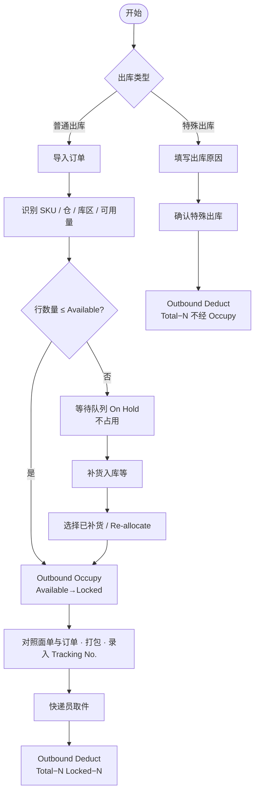

# KickBazar WMS — 出库模块产品需求说明（Outbound）

> **文档性质**：出库模块 **独立 PRD**（**2026-10 初版重梳**），与《KickBazar WMS 产品需求说明（仓库与库存）》(`KickBazar-WMS-PRD.md`) 配套。  
> **依据**：业务现状流程（无 WMS，商家后台 + Excel）、目标 WMS 流程（普通出库 / 特殊出库）。  
> **不包含**：仓库/库区主数据（§3–§4）、SKU 零库存初始化（§5.0.1）、采购/入库（独立 PRD）。

---

## 1 背景：现状 vs 目标

### 1.1 现状（无 WMS）

| 步骤 | 现状动作 | 痛点 |
|------|----------|------|
| 订单来源 | 商家后台 **导出订单** | 与仓内库存无自动校验 |
| 筛选 | 人工 **筛选有效订单** | 规则不统一 |
| 库存 | **检查是否足够** | Excel 库存滞后、易错 |
| 不足 | **采购补货** → 到货再发；**不占用**在途库存；新单有货可优先发 | 排队与优先级靠人工 |
| 足够 | 上传快递、**生成面单**、打包 | 与 WMS 脱节 |
| 留痕 | **出入库记录 Excel** | 与库存 Excel 双表维护 |
| 取件后 | **库存 Excel 手工 -N** | 账实易不一致 |
| 特殊出库 | 记入出入库 Excel **并备注原因** → 库存 -N | 无统一单号与权限 |

### 1.2 目标（WMS）

系统承接 **商家后台导出订单**（或 API，一期以 **Import CSV** 为主），在 **当前仓 `warehouse_context`** 下：

1. **普通出库**：识别 SKU 与 **Storage Zone** 可用量 → 足够则 **占用（Outbound Occupy）** → 打包录入 **快递单号** → 快递员取件后 **扣减（Outbound Deduct）**；不足则进入 **等待队列（On Hold）**，**不占用库存**，补货后 **再分配（Re-allocate）** 后走同一链路。
2. **特殊出库**：经办人 **必填出库原因**，不经占用，确认后 **直接扣减可用库存** 并写 **Outbound Deduct** 流水（关联特殊出库单号）。

写账口径与基础 PRD **§8.2** 一致；流水展示与 **§6.2** 一致。

---

## 2 模块目标与依赖

### 2.1 业务目标

| # | 目标 |
|---|------|
| 1 | 替代「出入库记录 Excel + 库存 Excel」双表，**单系统** 流水与库存 |
| 2 | 普通出库：**占用与扣减分离**，只有取件确认才减实物 |
| 3 | 缺货：**等待队列** + 补货后再分配；支持业务规则「缺货单不占用，有货新单可先发」（通过 On Hold 不锁库存实现） |
| 4 | 特殊出库：原因留痕 + 直接扣减 |
| 5 | 与 Dashboard KPI（待分配/待打包/今日已发货）可聚合（见 §7） |

### 2.2 依赖（基础 PRD，强制）

| 依赖 | 说明 |
|------|------|
| **§5.0.2** | 写库存前须存在 `(sku_id, warehouse_code, zone_code)` 库存行 |
| **§8.1** | 普通出库占用/扣减目标为 **Enable** 的 **Storage Zone**（`zone_type_code = STO`） |
| **§8.2** | Occupy：`locked↑`、`available↓`；普通 Deduct：`locked↓`、`total↓`；打包/录入单号 **不写流水** |
| **§2.1** | `warehouse_context`；**Import / 写账须单仓**（上下文为 All 时导入弹窗选仓） |
| **入库 / 采购** | 补货通过 **Inbound / PO** 增加 `total`，不自动把 On Hold 行改为已占用 |

---

## 3 出库类型

| 类型 | 英文 | 典型场景 | 库存路径 |
|------|------|----------|----------|
| **普通出库** | Regular Outbound | 平台销售订单发货 | Occupy →（作业）→ Deduct |
| **特殊出库** | Special Outbound | 样品、报损出库、内部领用等 | 仅 Deduct（从 **Available** 扣，**不经过 Locked**） |

一期 **不做**「是否正常出库」分叉后的线下 Excel；两种类型均在 WMS 内完成。

---

## 4 编码与单号

| 单据 | 规则 | 示例 |
|------|------|------|
| **Outbound No.**（普通批次） | `OB` + `warehouse_code` + `yyyyMMdd` + 4 位流水；**一次 Import 一个号** | `OBSH001202610210001` |
| **Shipment No.** | `SHP` + `warehouse_code` + `yyyyMMdd` + 4 位流水；**每个 Tracking No. 一个**（多行同包裹可共用） | `SHPSH001202610210001` |
| **Tracking No.** | 承运商面单号；打包环节录入或 CSV 回导 | `SF1029384756` |
| **Special Outbound No.** | `SX` + `warehouse_code` + `yyyyMMdd` + 4 位流水；**一行确认可一单** | `SXSH001202610210001` |

`warehouse_code` 为 canonical 5 位（基础 PRD §3.2.1）。

---

## 5 普通出库 — 流程与状态

### 5.1 流程步骤（与现状映射）

| 顺序 | WMS 步骤 | 替代现状 |
|------|----------|----------|
| 1 | **Import Order**（校验表头、去重） | 商家后台导出 + 筛选 |
| 2 | 系统按 **当前仓 STO** 校验 `available ≥ qty` | 检查库存是否足够 |
| 3a | 足够：**Outbound Occupy**，行状态 **Allocated** | （原无占用，现显式锁定） |
| 3b | 不足：**On Hold**，进入等待队列，**不写 Occupy** | 等待 + 采购补货 |
| 4 | **Export Shipping Order**（可选）→ 线下对接快递 → **Import Tracking** 或行内录入 | 上传快递、生成面单 |
| 5 | 行状态 **Awaiting Pickup**（已录 Tracking，待取件） | 打包完成 |
| 6 | **Confirm Shipment**（快递员已取件）→ **Outbound Deduct**，行 **Shipped** | 取件后库存 Excel -N |
| 7 | 补货后在对 Hold 列表 **Re-allocate**（「选择已补货」） | 到货打包后合并到发运 |

**一期简化**：拣货单打印、Complete Picking / Packing **不作为独立库存节点**（与基础 PRD §8.2「打包不改库存」一致）；若作业需要，可作为 **Allocated / Awaiting Pickup** 上的可选操作，**不增加流水类型**。

### 5.2 行状态（Line Status）

| 状态 | 英文 | 进入条件 | 库存 |
|------|------|----------|------|
| **On Hold** | Waiting Queue | `available < qty` | 不变 |
| **Allocated** | To Pack | 分配成功，已 Occupy | `locked +N`，`available −N` |
| **Awaiting Pickup** | Ready for Courier | 已录入 Tracking No.（生成 Shipment No.） | 不变 |
| **Shipped** | Shipped | Confirm Shipment | `total −N`，`locked −N` |

导入完成时行 **仅可能** 为 **Allocated** 或 **On Hold**。

### 5.3 批次状态（Batch Status）

| 状态 | 规则 |
|------|------|
| **Pending Outbound** | 无 On Hold、无 Shipped |
| **Partially Outbound** | 存在 On Hold 或部分 Shipped |
| **Fully Outbound** | 全部行 Shipped |

### 5.4 分配规则

- 库区：**当前仓** 下 **Enable** 的 **Storage Zone**（默认 `SH001STO` 形态）。
- 粒度：**订单行 × SKU**（Import 一行一条作业行）。
- 并发：占用时 SQL 校验 `available ≥ qty`（与基础 PRD §5 一致）。
- **Re-allocate**：仅对 On Hold；仍用原 `warehouse_code` + STO 规则；成功则 Occupy + 变 Allocated。

### 5.5 缺货与补货策略（拍板）

- On Hold 行 **不占用** 现有 `available`，避免「占着不发」。
- 新导入订单若库存足够，**可立即 Allocated**，与旧 On Hold 单 **并行**（对应现状「新单有货优先发」）。
- 补货通过 **入库模块** 增加库存；WMS **不自动** 把 On Hold 改为 Allocated，需人工或批量 **Re-allocate**。

---

## 6 特殊出库 — 流程与字段

### 6.1 流程

1. 入口：**Outbound → Special Outbound**（或列表页「特殊出库」）。
2. 选择 **仓库**（默认 `warehouse_context`）、**库区（STO）**、**SKU**（仅展示已初始化库存行）、**数量**、**出库原因**（必填，下拉 + 备注）。
3. 确认前校验：`available ≥ qty`，仓/区 Enable。
4. 提交：生成 **Special Outbound No.**，写 **Outbound Deduct** 流水，`total −qty`，`locked` 不变，`available` 随 total 减少。
5. 流水详情扩展：**Outbound Type = Special**、**Reason**、无平台 Order No.（或可选关联外部单号）。

### 6.2 原因枚举（一期建议）

| Code | 中文 |
|------|------|
| `SAMPLE` | 样品 |
| `DAMAGE` | 破损/报损 |
| `INTERNAL` | 内部领用 |
| `OTHER` | 其他（备注必填） |

---

## 7 字段字典

### 7.1 订单导入模板（普通出库）

| 列名 | 必填 | 说明 |
|------|------|------|
| Order No | Y | 平台/商家订单号 |
| Order Time | N | 下单时间 |
| Product ID | N | 商品 ID（展示/对账） |
| SKU ID | Y | 须已在当前仓有库存行 |
| Product Name | N | 展示 |
| Specification | N | 规格 |
| Qty | Y | 正整数 |

**校验**：表头缺失、SKU 无库存行、Qty 非法 → 行失败明细；同批次 **Order No + SKU ID** 重复 → 忽略或报错（一期原型：**忽略并计数**）。

### 7.2 运单回导模板

| 列名 | 必填 | 说明 |
|------|------|------|
| Outbound No | N | 建议填 |
| Order No | Y | 匹配行 |
| SKU ID | Y | 匹配行 |
| Tracking No | Y | 承运商单号 |

匹配 **Allocated** 行；成功生成 **Shipment No.**，状态 → **Awaiting Pickup**。

### 7.3 出库批次（列表）

| 字段 | 说明 |
|------|------|
| outbound_no | OB… |
| outbound_type | `regular`（默认） |
| imported_at | 导入完成时间 |
| source_file | 原始文件名 |
| warehouse_code | 单仓 |
| order_count / sku_count / total_units | 聚合 |
| batch_status | §5.3 |

### 7.4 出库行（明细）

| 字段 | 说明 |
|------|------|
| line_id | 内部 ID |
| outbound_no | 所属批次 |
| order_no / order_time | 平台订单 |
| sku_id, product_name, specification | 商品 |
| qty | 数量 |
| warehouse_code, zone_code | 占用/扣减库区 |
| tracking_no, shipment_no | 打包后 |
| line_status | §5.2 |
| hold_reason | On Hold 时展示 |

### 7.5 特殊出库单

| 字段 | 说明 |
|------|------|
| special_outbound_no | SX… |
| warehouse_code, zone_code, sku_id, qty | 扣减目标 |
| reason_code, reason_note | 原因 |
| operator, created_at | 审计 |

### 7.6 库存流水（Record → Outbound）

与基础 PRD **§6.2** 一致：

| 流水类型 | 触发 | 关联单号 |
|----------|------|----------|
| Outbound Occupy | 普通分配成功 | OB… |
| Outbound Deduct | Confirm Shipment 或特殊出库 | OB… / SX… |

详情扩展：**Related Order No.**、**Shipment No.**、**Tracking No.**、**Line Status**；特殊出库增加 **Reason**。

---

## 8 页面与功能（一期）

| # | 页面 | 功能 |
|---|------|------|
| 1 | **Outbound Orders** | 流程说明条；筛选；**Import Order**；批次列表 |
| 2 | **Outbound Detail** | Tab：All / On Hold / Allocated / Awaiting Pickup / Shipped；批量 Export Shipping Order、Import Tracking、Confirm Shipment |
| 3 | **On Hold Orders** | 跨批次等待队列；**Re-allocate** |
| 4 | **Special Outbound** | 表单创建特殊出库 |
| 5 | **Record → Outbound** | 只读 Occupy / Deduct（基础 PRD） |

### 8.1 入口与权限

- **侧栏**：Outbound 分组；**Dashboard → Quick Actions → Outbound**。
- **角色**：Admin、所属仓仓管；数据范围 **§2.1**。

### 8.2 Dashboard KPI 聚合（与基础 PRD §7.1 对齐）

| KPI | 建议口径 |
|-----|----------|
| Pending Allocation | 批次已导入且存在 On Hold 或尚未全部 Allocated 的批次数/行数（产品可二选一，一期原型：**On Hold 行数**） |
| Pending Picking | **Allocated** 行数（待打包录单） |
| Pending Packing | **Awaiting Pickup** 行数 |
| Shipped Today | 当日 Confirm Shipment 的订单行数 |

---

## 9 写账与事务（与基础 PRD §8.2）

| 事件 | 实物 total | locked | available | Record |
|------|------------|--------|-----------|--------|
| 普通分配 Occupy | — | ↑ | ↓ | Outbound Occupy |
| Confirm Shipment | ↓ | ↓ | — | Outbound Deduct |
| 特殊出库确认 | ↓ | — | ↓ | Outbound Deduct |
| 录入 Tracking / 导出发货表 | — | — | — | 不写 |
| 补货入库 | ↑ | — | ↑ | Inbound（入库 PRD） |

占用、扣减与流水 **同一事务**；失败整行回滚。

---

## 10 非功能与后续

| 项 | 一期 | 后续 |
|----|------|------|
| 商家后台 API 拉单 | CSV Import | 对接订单 API |
| 快递面单 API | Export + 手工 Tracking | 直连承运商 |
| 拣货单 PDF | 可选打印 | 与 Axure 对齐 |
| 优先级队列 | On Hold 人工 Re-allocate | 自动策略配置 |

---

## 11 主 PRD 索引

| 主题 | 位置 |
|------|------|
| 库存行、匹配 | `KickBazar-WMS-PRD.md` §5.0.2 |
| 出库流水 Tab | §6.2 |
| 写账总表 | §8.2 |
| 仓库上下文 | §2.1 |

---

*本文档为出库模块唯一正文；基础 PRD §9 仅保留关联链接。*
