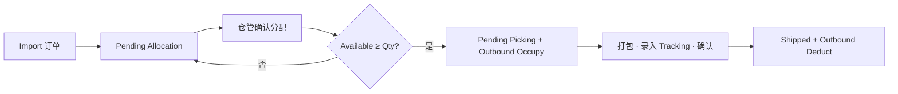

# KickBazar WMS — 出库模块产品需求说明（Outbound）

> **文档性质**：出库模块 **独立 PRD**（**2026-10 初版重梳**），与《KickBazar WMS 产品需求说明（仓库与库存）》(`KickBazar-WMS-PRD.md`) 配套。  
> **依据**：业务现状流程（无 WMS，商家后台 + Excel）、目标 WMS 流程（普通出库 / 特殊出库）。  
> **不包含**：仓库/库区主数据（§3–§4）、SKU 零库存初始化（§5.0.1）、采购/入库（独立 PRD）。

---

## 1 背景：现状 vs 目标

### 1.1 现状（无 WMS）

| 步骤 | 现状动作 | 痛点 |
|------|----------|------|
| 订单来源 | 商家后台 **导出订单** | 与仓内库存无自动校验 |
| 筛选 | 人工 **筛选有效订单** | 规则不统一 |
| 库存 | **检查是否足够** | Excel 库存滞后、易错 |
| 不足 | **采购补货** → 到货再发；**不占用**在途库存；新单有货可优先发 | 排队与优先级靠人工 |
| 足够 | 上传快递、**生成面单**、打包 | 与 WMS 脱节 |
| 留痕 | **出入库记录 Excel** | 与库存 Excel 双表维护 |
| 取件后 | **库存 Excel 手工 -N** | 账实易不一致 |
| 特殊出库 | 记入出入库 Excel **并备注原因** → 库存 -N | 无统一单号与权限 |

### 1.2 目标（WMS）

系统承接 **商家后台导出订单**（或 API，一期以 **Import CSV** 为主），在 **当前仓 `warehouse_context`** 下：

1. **普通出库（订单中心）**：**Import** → 行状态 **Pending Allocation**（不占库存）→ 仓管 **确认分配** → **Pending Picking** 且 **Outbound Occupy**（Available→Locked）→ 打包后在系统录入 **快递单号并确认** → **Shipped**，**Outbound Deduct**（Locked↓、Total↓）。
2. **特殊出库**：经办人 **必填出库原因**，不经占用，确认后 **直接扣减可用库存** 并写 **Outbound Deduct** 流水（关联特殊出库单号）。

写账口径与基础 PRD **§8.2** 一致；流水展示与 **§6.2** 一致。

---

## 2 模块目标与依赖

### 2.1 业务目标

| # | 目标 |
|---|------|
| 1 | 替代「出入库记录 Excel + 库存 Excel」双表，**单系统** 流水与库存 |
| 2 | 普通出库：**占用与扣减分离**，只有取件确认才减实物 |
| 3 | 缺货：**等待队列** + 补货后再分配；支持业务规则「缺货单不占用，有货新单可先发」（通过 On Hold 不锁库存实现） |
| 4 | 特殊出库：原因留痕 + 直接扣减 |
| 5 | 与 Dashboard KPI（待分配/待打包/今日已发货）可聚合（见 §7） |

### 2.2 依赖（基础 PRD，强制）

| 依赖 | 说明 |
|------|------|
| **§5.0.2** | 写库存前须存在 `(sku_id, warehouse_code, zone_code)` 库存行 |
| **§8.1** | 普通出库占用/扣减目标为 **Enable** 的 **Storage Zone**（`zone_type_code = STO`） |
| **§8.2** | Occupy：`locked↑`、`available↓`；普通 Deduct：`locked↓`、`total↓`；打包/录入单号 **不写流水** |
| **§2.1** | `warehouse_context`；**Import / 写账须单仓**（上下文为 All 时导入弹窗选仓） |
| **入库 / 采购** | 补货通过 **Inbound / PO** 增加 `total`，不自动把 On Hold 行改为已占用 |

---

## 3 出库类型

| 类型 | 英文 | 典型场景 | 库存路径 |
|------|------|----------|----------|
| **普通出库** | Regular Outbound | 平台销售订单发货 | Occupy →（作业）→ Deduct |
| **特殊出库** | Special Outbound | 样品、报损出库、内部领用等 | 仅 Deduct（从 **Available** 扣，**不经过 Locked**） |

一期 **不做**「是否正常出库」分叉后的线下 Excel；两种类型均在 WMS 内完成。

---

## 4 编码与单号

| 单据 | 规则 | 示例 |
|------|------|------|
| **Outbound No.**（普通批次） | `OB` + `warehouse_code` + `yyyyMMdd` + 4 位流水；**一次 Import 一个号** | `OBSH001202610210001` |
| **Shipment No.** | `SHP` + `warehouse_code` + `yyyyMMdd` + 4 位流水；**每个 Tracking No. 一个**（多行同包裹可共用） | `SHPSH001202610210001` |
| **Tracking No.** | 承运商面单号；打包环节录入或 CSV 回导 | `SF1029384756` |
| **Special Outbound No.** | `SX` + `warehouse_code` + `yyyyMMdd` + 4 位流水；**一行确认可一单** | `SXSH001202610210001` |

`warehouse_code` 为 canonical 5 位（基础 PRD §3.2.1）。

---

## 5 普通出库 — 流程与状态

### 5.1 页面结构（参考订单中心）

一期出库主界面为 **订单行列表**（非批次表），顶部 **状态 Tab**（与参考 OMS 一致）：

| Tab | 英文状态 | 说明 |
|-----|----------|------|
| 待分配 | **Pending Allocation** | Import 后默认；**不占库存** |
| 拣货中 | **Pending Picking** | 仓管确认分配后；已 **Outbound Occupy** |
| 已出库 | **Shipped** | 录入快递单号并确认后；已 **Outbound Deduct** |
| 全部 | All | 汇总 |

支持筛选：Order No.、SKU ID、**Shipping No.**；列表列含 **Zone**；**Warehouse** 列仅 **Admin 且仓库上下文 = All** 时展示。工具栏 **Import**、**Confirm Allocation**、行内 **Pack & Ship**。

### 5.2 流程步骤（与库存写账）

| 顺序 | 操作 | 行状态 | 库存 / 流水 |
|------|------|--------|-------------|
| 1 | **Import Order**（校验表头） | **Pending Allocation** | 不变 |
| 2 | 仓管勾选并 **Confirm Allocation** | 成功 → **Pending Picking**；失败保持待分配并提示缺货 | 成功：**Outbound Occupy**（`locked↑`、`available↓`） |
| 3 | 线下打包、对照面单 | **Pending Picking** | 不变 |
| 4 | 系统内录入 **Shipping No.**（面单/快递单号）并 **确认发货** | **Shipped** | **Outbound Deduct**（`locked↓`、`total↓`） |

分配失败时行仍为 **Pending Allocation**，可补货后再次确认分配（不自动占用）。

### 5.3 行状态（Line Status）

| 状态 | 英文 | 库存 |
|------|------|------|
| **Pending Allocation** | 待分配 | 不变 |
| **Pending Picking** | 拣货中 | 已占用：locked 含本行 qty |
| **Shipped** | 已出库 | 实物已扣减 |

**导入完成时** 行状态 **仅为 Pending Allocation**。

### 5.4 批次状态（Batch Status）

| 状态 | 规则 |
|------|------|
| **Pending Outbound** | 无 On Hold、无 Shipped |
| **Partially Outbound** | 存在 On Hold 或部分 Shipped |
| **Fully Outbound** | 全部行 Shipped |

### 5.5 分配规则

- 库区：**当前仓** 下 **Enable** 的 **Storage Zone**（默认 `SH001STO` 形态）。
- 粒度：**订单行 × SKU**（Import 一行一条作业行）。
- 并发：占用时 SQL 校验 `available ≥ qty`（与基础 PRD §5 一致）。
- **Re-allocate**：仅对 On Hold；仍用原 `warehouse_code` + STO 规则；成功则 Occupy + 变 Allocated。

### 5.6 缺货、拆单与补货（拍板）

作业粒度：**Import 一行 = Order No.（MerchantOrderID）× 一个 SKU 行**，同一商家订单多 SKU 为多行，**状态独立**。

| 场景 | 行为 |
|------|------|
| 一单多 SKU，部分 SKU 有货 | 有货行可 **Confirm Allocation → 发货**；缺货行保持 **Pending Allocation**（先寄有货，等价拆成多票发运） |
| 同一 SKU 行数量不足 | 该行保持 **Pending Allocation**，**不占用**；其他订单有货可先发 |
| 补货入库后 | 对待分配行再次 **Confirm Allocation** |

与流程图一致：缺货进等待队列、不占用；补货后「选择已补货」= 再次确认分配。

### 5.7 与流程图对照（2026-10 修订）

| 流程图节点 | 系统实现 | 备注 |
|------------|----------|------|
| 导入订单 → pending allocation | Import **订单列表.xlsx** | ✓ 一致 |
| 仓管选择分配 → pending picking | **Confirm Allocation** + Occupy | ✓ 一致 |
| 库存不足 → 等待、不占用 | 分配失败，保持 Pending Allocation | ✓ 一致 |
| 补货后再占用 | 入库后再次 Confirm Allocation | ✓ 一致 |
| 打包录入单号 → shipped + deduct | **Pack & Ship** + Shipping No. | ✓ 一致（录入与扣减一步完成） |
| 特殊出库 | Special Outbound 页 | ✓ 一致 |

---

## 6 特殊出库 — 流程与字段

### 6.1 流程

1. 入口：**Outbound → Special Outbound**（或列表页「特殊出库」）。
2. 选择 **仓库**（默认 `warehouse_context`）、**库区（STO）**、**SKU**（仅展示已初始化库存行）、**数量**、**出库原因**（必填，下拉 + 备注）。
3. 确认前校验：`available ≥ qty`，仓/区 Enable。
4. 提交：生成 **Special Outbound No.**，写 **Outbound Deduct** 流水，`total −qty`，`locked` 不变，`available` 随 total 减少。
5. 流水详情扩展：**Outbound Type = Special**、**Reason**、无平台 Order No.（或可选关联外部单号）。

### 6.2 原因枚举（一期建议）

| Code | 中文 |
|------|------|
| `SAMPLE` | 样品 |
| `DAMAGE` | 破损/报损 |
| `INTERNAL` | 内部领用 |
| `OTHER` | 其他（备注必填） |

---

## 7 字段字典

### 7.1 订单导入文件（`订单列表.xlsx`）

| 表格列 | 系统字段 | 规则 |
|--------|----------|------|
| **MerchantOrderID** | **Order No.** | 商家订单号；同一 ID 可多行（多 SKU） |
| **ItemQuantity** | **Qty** | 正整数；优先于 ItemDesc 内数量 |
| **ItemDesc** | Product Name + SKU | 解析 `qty*Product Name-SKU`（可含【】）；示例：`2*Wireless Bluetooth Earbuds Pro-SKU-10001-BK` |

- 导入后每行 **Pending Allocation**；须匹配仓内 **SKU 库存行**（§5.0.2），否则分配失败。
- 样例 CSV：[`docs/fixtures/订单列表-import-sample.csv`](fixtures/订单列表-import-sample.csv)。
- **仓库**：Import 弹窗选仓仅 **Admin + 上下文 All**；仓管固定所属仓。

### 7.2 列表与作业字段

| 字段 | 说明 |
|------|------|
| **Zone** | 确认分配后写入目标 **Storage Zone**（如 `SH001STO`） |
| **Shipping No.** | 打包确认时录入（原 Tracking No. 口径统一为本字段） |
| **Warehouse** | 列表仅 Admin+All 展示 |

### 7.3 运单批量回导（可选）

| 列名 | 必填 | 说明 |
|------|------|------|
| Order No | Y | MerchantOrderID |
| SKU ID | Y | 匹配行 |
| Shipping No | Y | 确认发货并 Deduct |

### 7.4 出库批次（列表）

| 字段 | 说明 |
|------|------|
| outbound_no | OB… |
| outbound_type | `regular`（默认） |
| imported_at | 导入完成时间 |
| source_file | 原始文件名 |
| warehouse_code | 单仓 |
| order_count / sku_count / total_units | 聚合 |
| batch_status | §5.3 |

### 7.5 出库行（明细）

| 字段 | 说明 |
|------|------|
| line_id | 内部 ID |
| outbound_no | 所属批次 |
| order_no / order_time | 平台订单 |
| sku_id, product_name, specification | 商品 |
| qty | 数量 |
| warehouse_code, zone_code | 占用/扣减库区 |
| tracking_no, shipment_no | 打包后 |
| line_status | §5.2 |
| hold_reason | On Hold 时展示 |

### 7.6 特殊出库单

| 字段 | 说明 |
|------|------|
| special_outbound_no | SX… |
| warehouse_code, zone_code, sku_id, qty | 扣减目标 |
| reason_code, reason_note | 原因 |
| operator, created_at | 审计 |

### 7.7 库存流水（Record → Outbound）

与基础 PRD **§6.2** 一致：

| 流水类型 | 触发 | 关联单号 |
|----------|------|----------|
| Outbound Occupy | 普通分配成功 | OB… |
| Outbound Deduct | Confirm Shipment 或特殊出库 | OB… / SX… |

详情扩展：**Related Order No.**、**Zone**、**Shipping No.**、**Line Status**；特殊出库增加 **Reason**。

---

## 8 页面与功能（一期）

| # | 页面 | 功能 |
|---|------|------|
| 1 | **Outbound Orders** | 状态 Tab 列表（参考 OMS）；Import；Confirm Allocation；Pack & Ship |
| 2 | **Outbound Detail**（可选） | 按 Outbound No. 查看同批次行 |
| 3 | **Special Outbound** | 表单创建特殊出库 |
| 4 | **Record → Outbound** | 只读 Occupy / Deduct（基础 PRD） |

### 8.1 入口与权限

- **侧栏**：Outbound 分组；**Dashboard → Quick Actions → Outbound**。
- **角色**：Admin、所属仓仓管；数据范围 **§2.1**。

### 8.2 Dashboard KPI 聚合（与基础 PRD §7.1 对齐）

| KPI | 建议口径 |
|-----|----------|
| Pending Allocation | **Pending Allocation** 行数 |
| Pending Picking | **Pending Picking** 行数 |
| Pending Packing | 一期与 Pending Picking 合并展示（可选隐藏该 KPI） |
| Shipped Today | 当日确认发货（Pack & Ship）的行数 |

---

## 9 写账与事务（与基础 PRD §8.2）

| 事件 | 实物 total | locked | available | Record |
|------|------------|--------|-----------|--------|
| Confirm Allocation（普通） | — | ↑ | ↓ | Outbound Occupy |
| Pack & Confirm Shipment | ↓ | ↓ | — | Outbound Deduct |
| 特殊出库确认 | ↓ | — | ↓ | Outbound Deduct |
| 录入 Tracking / 导出发货表 | — | — | — | 不写 |
| 补货入库 | ↑ | — | ↑ | Inbound（入库 PRD） |

占用、扣减与流水 **同一事务**；失败整行回滚。

---

## 10 非功能与后续

| 项 | 一期 | 后续 |
|----|------|------|
| 商家后台 API 拉单 | CSV Import | 对接订单 API |
| 快递面单 API | Export + 手工 Tracking | 直连承运商 |
| 拣货单 PDF | 可选打印 | 与 Axure 对齐 |
| 优先级队列 | On Hold 人工 Re-allocate | 自动策略配置 |

---

## 11 主 PRD 索引

| 主题 | 位置 |
|------|------|
| 库存行、匹配 | `KickBazar-WMS-PRD.md` §5.0.2 |
| 出库流水 Tab | §6.2 |
| 写账总表 | §8.2 |
| 仓库上下文 | §2.1 |

---

*本文档为出库模块唯一正文；基础 PRD §9 仅保留关联链接。*
